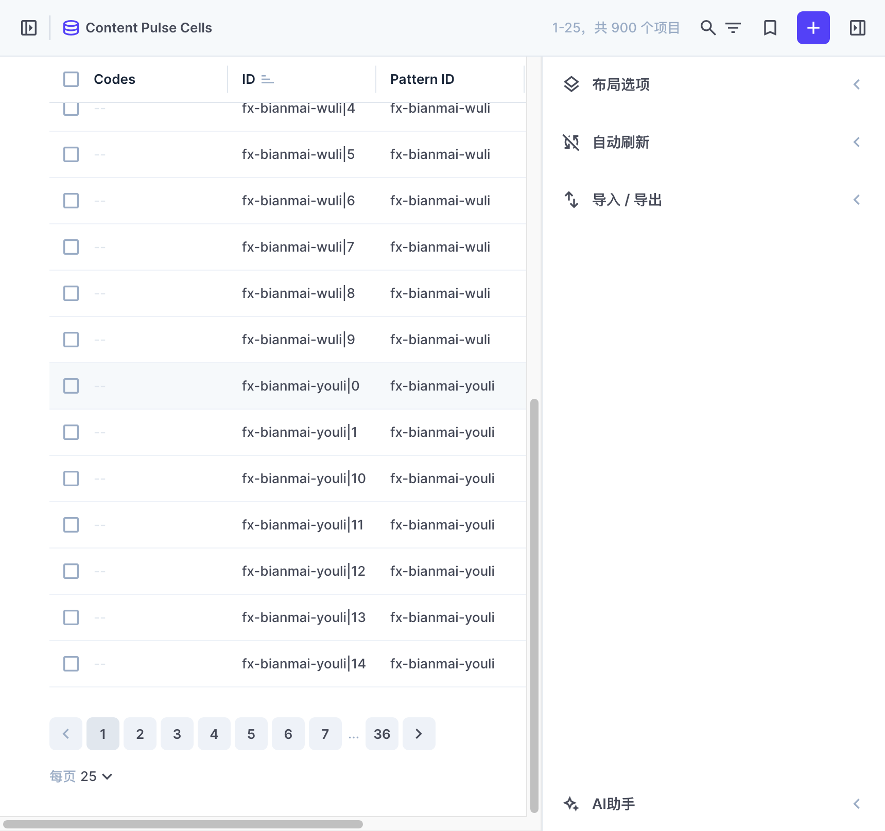
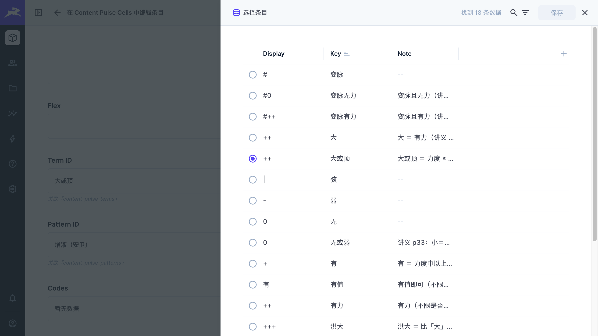
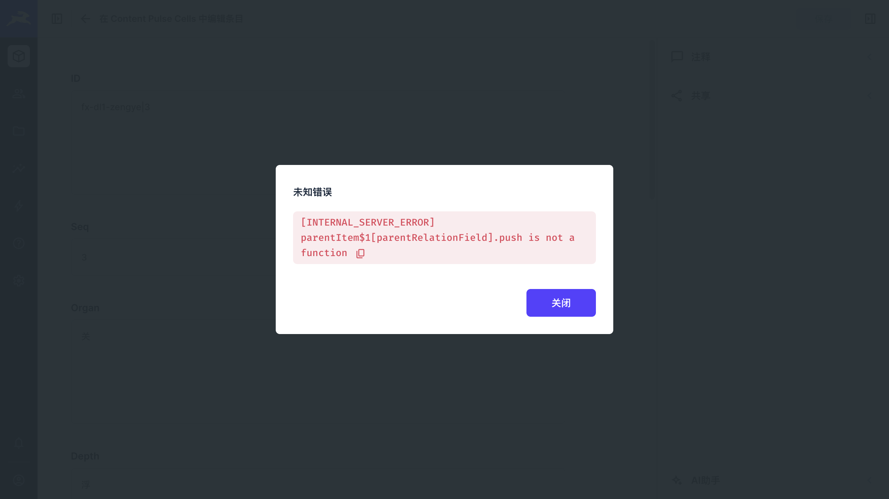

# 本地后台选型 —— M0 实测结论

> **一句话结论**：**M0-B（本地 SQLite ＋ Directus 容器）成立** ——
> D4＝SQLite、D10＝Directus 不变，按已批准的计划 v8 继续走 M1~M7。
>
> 但实测**推翻了计划里的两个乐观假设**（复合主键能用／WAL 能跨进程共享），
> 两处都已就地修正并写进了代码注释与断言。**没有一条假设被带进下一阶段。**

- 实施计划（canonical）：`~/.minimax/v2/sessions/2026/11/02/03-37-13-904-session_bXZzXzc4YmIxZTViOGJmZTRhNWM4YzQ1YzE3NTkyZTBlYWYy/artifacts/plan.md`
- 本地内容层现状：`docs/content-layer.md`（**该文档仍描述 Excel 时代**，M6 会随新流程重写）
- 发布管道：`docs/content-publish.md`（M2／M3 的远端结构与命令）
- 实测日期：2026-11-11（选型）｜2026-11-12（人眼确认与修复，§3.4／§3.5／§5.1）

---

## 1. 环境与版本

| 项 | 值 |
|---|---|
| 机器 | macOS 24.6.0（x64） |
| Docker Desktop | 4.91.0 ／ 引擎 29.8.0 ／ CLI 29.8.0 |
| Directus | **12.6.1**（`directus/directus:12.6.1`） |
| 镜像 digest | `sha256:e1561b5e526e8e7a2ac19b7bb6eab63611dd84a862a8c45b864118768a2baff4` |
| 镜像体积 | **1.11 GB**（磁盘余量 14 GiB，够用） |
| Node | v24.12.0（内置 `node:sqlite`，**零新增 npm 依赖**） |
| 内容库 | `local-data/content.sqlite`（17 张内容表 ＋ Directus 系统表同库） |

> ⭐ **Docker Desktop 本机已装**（`/Applications/Docker.app`）——计划 v5 估的「一次性安装成本」
> 是错的，M0 的门槛从来只剩「锁能不能用」这一个技术问题。

---

## 2. 六条验收，逐条给结论

| # | 验收项（计划 §6.2） | 结论 | 证据 |
|---|---|---|---|
| ① | 中文界面可用 | ✅ | 登录页已是中文（邮箱／密码／登录／忘记密码）；项目默认语言与用户语言都设为 `zh-CN` |
| ② | introspect 自动列出表并生成表单 | ✅ | **17/17** 张内容表全部被接管，每张都有字段与主键 |
| ③ | M2O 关系字段点选（显示中文用字名） | ✅（**人眼确认通过**） | 10 条外键升级成 Directus 关系；点开一格，下拉展开**正好 18 条用字**，当前值直接显示中文「**大或顶**」（不是 id）—— 截图见 §5.1。⚠️ 第一次人眼确认时**整个抽屉 500**，根因见 §3.4 |
| ④ | 多值下拉（symbols 多选） | ⚠️ **受限** | `codes` 是 `jsonb` 列，Directus 的多选界面只服务**关系字段**；且实测 **`codes` 在 900 行里 0 处有值**（有值的 96 格是「用字位」，`codes` 全空）—— 见 §5.2 |
| ⑤ | 按 `pattern_id` 过滤后只显示 18 行 | ✅（机制层） | `GET /items/content_pulse_cells?filter[pattern_id][_eq]=fx-ssx-qingdanglu` 返回**正好 18 行**（左 9 ＋ 右 9，含用字 6 格）；并已预置「一张图 18 行」的视图预设 |
| ⑥ | 内存占用与首次启动时间 | ✅ | **冷启动 11.6 s** 到可服务；稳态内存 **287 MiB**（本机 7.75 GiB 的 3.7%）；镜像 1.11 GB |

**R-Edit（硬约束）**：全部内容表都在后台里以**表格＋表单**呈现，可直接编辑。
**全程不碰命令行**这条在 §3.2 的踩坑里尤其值钱 —— 那个坑从命令行根本看不出来。

---

## 3. 三个实测出来的硬约束（都已写进代码注释）

### 3.1 ⚠️ Directus **只认单列主键**，复合主键的表会被**整表忽略**

Directus 12.6.1 的 SQLite schema inspector（`packages/schema/src/dialects/sqlite.ts`）：

```js
const primaryKeys = columns.filter((column) => column.pk !== 0);
overview[table] = {
  primary: primaryKeys.length !== 1 ? void 0 : primaryKeys[0].name,   // ← 复合主键 ⇒ undefined
  ...
};
```

而 `get-schema.js` 拿到 `primary === undefined` 就直接跳过整张表：

```
WARN: Collection "content_pulse_cells" doesn't have a primary key column and will be ignored
```

**后果**：M1 设计的 6 张复合主键表（`content_pulse_cells`／`content_rule_formulas`／
`content_rule_drugs`／`content_group_positions`／`content_term_codes`／`content_term_also`）
**全部被忽略** —— 其中 `content_pulse_cells` 正是整个编辑面的核心（18 格矩阵）。
（PG 那套 inspector 也一样：它把复合主键压成单列，主键会认错。）

**处置**：给这 6 张表各加一个**派生的单列代理键 `id`**（＝「父键｜序号」），
原复合列降为普通列。规则写在 schema 的 `x-tables.derivedId` 里（**唯一来源**），
落库时生成、导出时丢弃（它不是内容），并新增断言 **A5** 核对「`id` 与派生规则是否一致」。

| 表 | `id` 取值 |
|---|---|
| `content_pulse_cells` | `pattern_id｜seq`（如 `fx-ssx-qingdanglu｜0`） |
| `content_rule_formulas` / `content_rule_drugs` | `rule_id｜seq` |
| `content_group_positions` | `group_id｜seq` |
| `content_term_codes` / `content_term_also` | `term_key｜seq` |

> 这是关系型建模里的标准做法（复合键 → 代理键）。
> **本地 SQLite 与远端 PG 由同一份 schema 生成 DDL，两边照样同名同列同语义**，
> 发布脚本仍是「同构 → 同构」的直接搬运。

### 3.2 ⚠️ WAL 模式下**两个 SQLite 实例共享同一个库文件会互相毁掉对方的 WAL**

**这是 M0 最险的一个坑，症状极具迷惑性**：

- 宿主机脚本与容器里的 Directus 是**两个独立的 SQLite 实例**，共享同一个 `content.sqlite`。
- WAL 模式靠 `-wal`／`-shm` 两个**常驻文件**共享数据。
- 宿主机连接一关闭，SQLite 会 checkpoint 并 **unlink** 这两个文件；
  容器里的 Directus 仍握着**已删除 inode** 的 fd ⇒ **它的写入全部凭空消失**。

实测症状：

```
API 说：  {"data":{"id":"fx-bianmai-wuli","title":"写坏测试标题", ...}}   ← 200，看起来成功
宿主机读： "三焦疗法·肾虚"                                                ← 纹丝不动
容器内读： "三焦疗法·肾虚"                                                ← 连容器自己都读不到
/proc/44 -> /data/content.sqlite-shm (deleted)
/proc/44 -> /data/content.sqlite-wal (deleted)
```

**处置**：内容库统一 `PRAGMA journal_mode = DELETE`
（写在 `scripts/lib/content-db.mjs` 的 `openDb()` 里，附完整说明）。
DELETE 模式没有那个常驻共享文件 ⇒ 两个进程可以安全地先后访问同一个文件。
内容库是单人编辑、并发需求为零，**WAL 的收益本来就用不上**。

> ⚠️ **业务库（`server/db.mjs`）仍用 WAL** —— 那是另一份库、另一种访问模式，**别照抄**。

### 3.3 ⚠️ bind-mount 不能挂在 `/directus`

镜像里 Directus 的应用本体就装在 `/directus`，挂到那儿会把应用目录整个盖掉：

```
Error: Cannot find module '/directus/docker-entrypoint.cjs'
```

**处置**：挂到 `/data`，`DB_FILENAME=/data/content.sqlite`。

### 3.4 ⚠️⚠️ `meta.one_field` 一填，**被引用方的整张表在后台里点不开**

**这是 M0 人眼确认环节抓出来的** —— 在那之前，所有自动化断言都是绿的。

#### 症状

打开 `content_pulse_cells` 的一格（`/admin/content/content_pulse_cells/fx-dl1-zengye|3`）直接弹：

```
[INTERNAL_SERVER_ERROR]
parentItem$1[parentRelationField].push is not a function
```

而且不止这一格 —— **凡是「被引用方」集合的列表接口都 500**：

| 请求 | 结果 |
|---|---|
| `GET /items/content_sciences?fields=id,name,ratio,page` | ❌ 500 |
| `GET /items/content_sciences?fields=name,ratio`（去掉 `id`） | ✅ 200 |
| `GET /items/content_pulse_cells?fields=*`（没有反向关系） | ✅ 200 |

⇒ 后台里「科学中药比例」「同和堂版成方」「讲稿方剂条目」「脉象图本体」这几张表**全都点不开**。

#### 根因

Directus 12 的 `getRelation()` 是**双向匹配**的（`@directus/utils`）：

```js
function getRelation(relations, collection, field) {
  return relations.find((relation) => {
    return relation.collection === collection && relation.field === field
        || relation.related_collection === collection && relation.meta?.one_field === field;
  });
}
```

读「被引用方」集合（比如 `content_sciences`）时，如果请求的**列名恰好等于某条关系的 `meta.one_field`**
（`one_field` 就是主键名 ⇒ **必然命中**），Directus 会把这个**标量列**当成**反向 o2m 关系**，
于是在 `merge-with-parent-items.js` 的 o2m 分支里：

```js
const parentRelationField = nestedNode.fieldKey;          // = 'id'
if (!parentItem$1[parentRelationField]) parentItem$1[parentRelationField] = [];
...
parentItem$1[parentRelationField].push(nestedItem$1);      // ← 挂在字符串上 ⇒ TypeError
```

`run-ast.js` 里那句 `delete items[nestedNode.fieldKey]` 对**数组**无效（只删了数组对象上的属性），
所以每行仍带着自己的 `id`（字符串）⇒ `.push` 不存在 ⇒ 整个接口 500。

#### 处置

**`meta.one_field` 一律置 `null`**。正向 m2o **不需要**它 —— 靠 `collection + field` 匹配就够了，
下拉照常工作；反向 o2m 展开我们用不到。

外键指向**非主键**的（`content_alias.target` → `content_drugs.name`，存的是方名）
干脆**不建 Directus 关系**，字段按普通文本处理 —— Directus 的 M2O 存的是主键值，建了也对不上。

⇒ 关系数从 11 条变成 **10 条关系 ＋ 1 个普通文本字段**。

### 3.5 ⚠️ `--check` 原来会真写

`content-admin-init.mjs --check` 无论有没有 `--check` 都发 `PATCH` ——
「核对」却真的改了远端，跑一次 `--check` 就等于改了一次配置，没法当验收用。
现在 `--check` 走 `GET` 比对远端现状，正常模式才 `PATCH`。

---


| 计划里写的 | 实测 | 处置 |
|---|---|---|
| 「16 张内容表」 | **17 张** | 计划自身的计数笔误（它的表清单本身就是 17 行）—— 以清单为准 |
| 复合主键的连接表／格位表 | Directus **整表忽略** | 6 张表加派生代理键 `id`（§3.1）＋ 新增断言 A5 |
| 本地库沿用 `server/db.mjs` 的 WAL 写法 | 双实例共享会**丢写入** | 内容库改 DELETE 模式（§3.2），业务库不动 |
| 外键关系需要人工在后台配 | Directus 12 **自动内省**出 11 条关系（`meta` 为 `null`） | 用 `PATCH /relations/{集合}/{字段}` 补 `meta`，并把关系字段的界面设成 `select-dropdown-m2o`；全部由 `scripts/content-admin-init.mjs` **从 schema 的 `fk` 声明自动推导**，可重复执行。⭐ **`meta.one_field` 必须留 `null`**（填了会让被引用方整张表 500 —— §3.4）；⭐ 另配集合级 `display_template`（`{{name}}`），下拉才显示人话而不是 id |
| 「M0-A：本地 PG 容器兜底」 | **不需要** | M0-B 全程成立，未启用 M0-A ⇒ **未新增 `pg` 依赖** |
| 「M0-C：桌面 GUI」 | 已排除 | 不满足 R-Edit，未测 |

**新增的两个「计划外但必须补」的东西**（都已补，不改方向）：

- `scripts/content-admin.mjs` —— 容器启停（`up`／`down`／`status`／`reset`），
  把上面三条硬约束固化在脚本里，避免下次有人改错。
- `scripts/content-admin-init.mjs` —— 关系 ＋ 字段界面 ＋ 视图预设的初始化，幂等。

---

## 5. 尚未闭环的项

### 5.1 界面里的人眼确认与截图 —— ✅ **已闭环**（2026-11-12）

登录 `http://localhost:8055/admin`（账号见 §6）走了一遍。

**① 列表页**（`content_pulse_cells`，900 行 ＝ 50 张图 × 18 格）



**② 打开一格**（`fx-dl1-zengye|3`）—— 用字下拉直接显示中文



- `Term ID` = **「大或顶」**（中文用字名，不是 id）
- `Pattern ID` = **「增液（安卫）」**（图名，不是 `fx-dl1-zengye`）
- 下拉展开**正好 18 条数据** ＝ 18 个原文用字
- 符号列 `Display` 也在（`++` / `0` / `-` / `|` / `#`…），跟讲义 p34 的符号体系一致
- `Note` 列带出处（「讲义 p33：小＝无、弱」「虚脏 ＝ 弱或无（讲稿 2010·第十四讲）」…）

**③ ⚠️ 第一次来是坏的**（修复前的现场）



打开抽屉直接弹 `INTERNAL_SERVER_ERROR`。根因见 **§3.4** —— 这个坑在自动化全绿的时候就已经存在，
是**人眼确认**抓出来的（所以这一项不能只靠断言）。

⇒ 验收项 ③ 从「✅（配置层）」升级为「✅（人眼确认通过）」。

**新增的断言**（`scripts/lib/content-admin-checks.mjs`，按结构解析，不搜关键词）：

| id | 断言 |
|---|---|
| **A6** | 每张内容表的列表接口（`?limit=1` 与 `?fields=*`）都是 200 |
| **A7** | 每条关系的 `meta.one_field` 都是 `null` |
| **A8** | 关系字段是 `select-dropdown-m2o`；指向非主键的字段是普通文本 `input` |
| **A9** | 被引用集合的 `display_template` ＝ schema 声明的显示列 |

「故意写坏」的验证（`scripts/e2e/content-admin-break.mjs`）：把 `one_field` 填回去 → **必须被 A6／A7 抓到**；
把界面改坏 → A8；把 `display_template` 改错 → A9；恢复后必须重新全绿。
实测 **7/7 通过**（含反向「好配置一条都不报」的防假绿检查）。

### 5.2 验收项 ④ 的结论：**多值下拉在当前 schema 下做不到，但当前内容也不需要**

- `content_pulse_cells.codes` 是 `jsonb` 列（计划 §3 定的），Directus 的
  `select-multiple-dropdown`／`select-multiple-checkbox` 是**关系界面**，
  值是「关联项主键数组」，**不能直接渲染 JSON 数组**。
- 实测 **`codes` 在 900 行（50 张图 × 18 格）里 0 处有值**
  （有值的 96 格是「用字位」，它们的 `term_id` 有中文用字、`codes` 全空）⇒ 当前内容**根本用不到**多选。
- 真要在格位上选符号，得把它改成**连接表**（`content_cell_symbols` ＋ M2M 关系），
  即多一张表、多一层 junction 关系。

⇒ **列为待拍板项**（计划 §11.1 一类），默认**保持 `jsonb` 不动**。

### 5.3 派生 `id` 的编辑风险

代理键是**算出来的**。后台里手工新增一行时，人得自己填对 `id`（如 `fx-ssx-qingdanglu｜3`），
否则 `id` 与「父键｜序号」对不上 —— 断言 **A5** 会抓到，发布脚本也会挡住。
风险可控，但**在后台界面上给这 6 张表做「新增行」不太友好**，M6 若做定制页可考虑自动生成。

---

## 6. 怎么复现

```bash
cd pulse-record

# ① 起本地后台（自动拉镜像 1.11 GB、挂载 local-data → /data）
node scripts/content-admin.mjs up
#    → http://localhost:8055/admin
#    → 账号 admin@example.com　密码 PulseLocal2026（本地临时凭据，可改）

# ② 配关系与视图（幂等；从 schema 的 fk 声明自动推导）
node scripts/content-admin-init.mjs
node scripts/content-admin-init.mjs --check    # 只读核对（不会写）

# ③ 灌库（首次）／校验
node scripts/content-seed.mjs
node scripts/content-seed.mjs --check

# ④ 断言的「故意写坏」验证（16/16）
node scripts/e2e/content-schema-break.mjs

# ⑤ 后台配置的只读核对（A6~A9）
npm run content:admin:check

# ⑥ 后台配置的「故意写坏」验证（7/7，会改配置并在 finally 里恢复）
npm run test:e2e:content:admin

# 停
node scripts/content-admin.mjs down
```

**底层等价命令**（脚本只是把它固化下来）：

```bash
docker run -d --name pulse-directus -p 8055:8055 \
  -v "$PWD/local-data:/data" \
  -e DB_CLIENT=sqlite3 -e DB_FILENAME=/data/content.sqlite \
  -e ADMIN_EMAIL=admin@example.com -e ADMIN_PASSWORD=PulseLocal2026 \
  -e KEY=... -e SECRET=... -e TELEMETRY=false -e CACHE_ENABLED=false \
  directus/directus:12.6.1
```

---

## 7. 下一步（按计划 v8）

| 阶段 | 内容 | 状态 |
|---|---|---|
| M0 | 本地后台选型验证 | ✅ **已完成**（2026-11-12 补完人眼确认与截图；抓出并修掉 §3.4 的 500） |
| M1 | 内容 schema ＋ 本地库建表 | ✅ **已完成**（8 份 schema、DDL 生成器、灌库、断言 A1~A5＋往返） |
| M2 | 远端 PG 内容表 ＋ RPC | ✅ **已完成**（`content` schema 17 表 ＋ `content_meta` 账本表 ＋ 6 个 RPC，见 `docs/content-publish.md`） |
| M3 | 发布命令 | ✅ **已完成**（`content:publish` 五步流水线 ＋ 快照／状态／回滚） |
| M4~M7 | Excel 退役／前端接内容／定制后台页／迁移收尾 | ⏭ 待做（**M4 卡在「两条编辑路线取哪条」的拍板上**） |

**待拍板（计划 §11.1）**：

- ① **两条「知识库怎么改」的路子取哪条** —— ①本地后台＋发布管道（退役 Excel，本轮这条）
  ②服务端管理员覆盖层（保留 Excel，另一条线）。两条已在 `feat/web-site` 上合并，功能都能用，
  但长期只留一条才是答案。**这条卡住 M4。**
- ③ `docs/填写流程图.html` 退役是否可接受
- ④ `pulse`（NoSQL，2026-12-06 到期）留不留
- ⑤ 本地后台是否常驻
- ＋ 验收项 ④ 的 `codes` 是否改成连接表（§5.2，默认不动）
